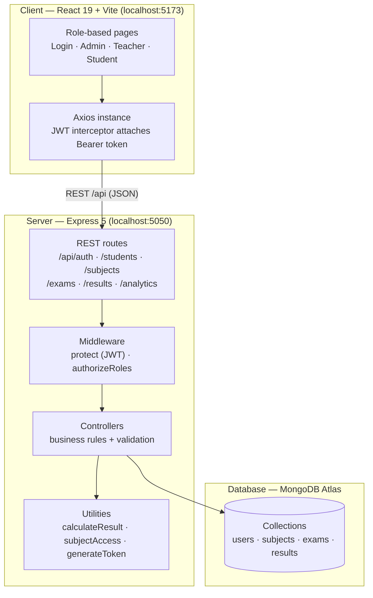
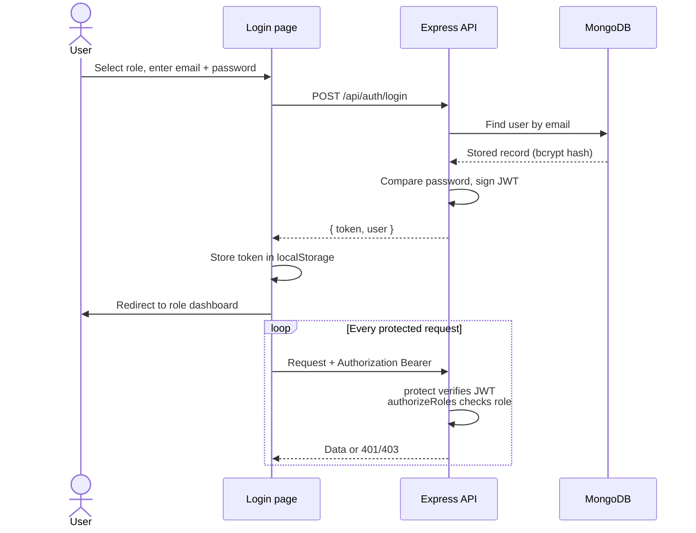
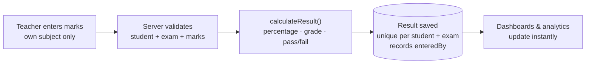
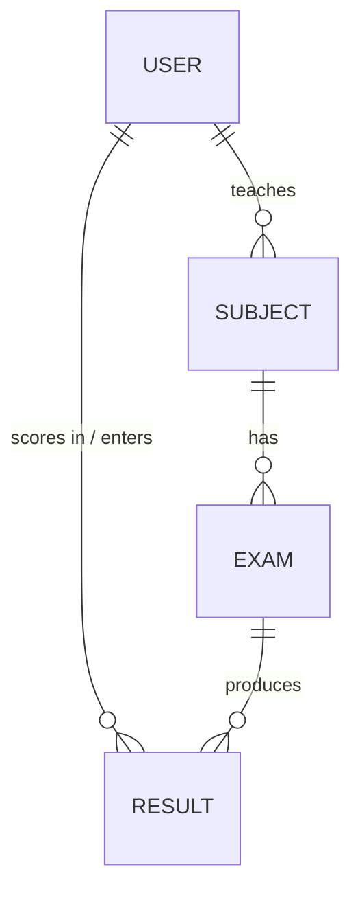

<div align="center">


# 🎓 ResultHub — Student Result Management System

**A full-stack MERN application for managing students, subjects, examinations, marks, and academic results — with role-based portals for administrators, teachers, and students.**

[](https://github.com/fariduddinahmed1/resulthub/actions/workflows/ci.yml)


</div>

---

## 📖 Project Overview

ResultHub is a college-level **Student Result Management System** that replaces manual marks registers and spreadsheets with a single, role-based web application. Administrators manage the academic record — students, teachers, subjects, examinations, and results. Teachers enter marks for the subjects assigned to them. Students view their own results, grades, and performance trends.

Every result is computed server-side (percentage, grade, pass/fail) the moment marks are entered, and the same data feeds institution-wide analytics: average percentage, pass rate, grade distribution, and subject-wise performance.

The system is built as a classic **MERN** monorepo — a React (Vite) single-page application talking to an Express REST API backed by MongoDB (running locally or on **MongoDB Atlas**).

## ❓ Problem Statement

Academic institutions record examination marks manually — on paper registers or shared spreadsheets. This leads to:

- **Error-prone calculations** — percentages, grades, and pass/fail status computed by hand (or not at all);
- **No centralized record** — student and subject data scattered across files, hard to query or secure;
- **Slow reporting** — producing grade distributions or subject-wise performance takes hours of manual aggregation;
- **No controlled access** — anyone with the file can view or edit everything.

ResultHub solves this with a single database, automatic result computation, instant analytics, and strict role-based access so each user sees only what they should.

## ✨ Key Features

### 🔐 Authentication & Authorization
- JWT-based authentication with bcrypt-hashed passwords (10 rounds)
- Role-based access control for **Admin**, **Teacher**, and **Student**
- Login page with a three-role selector; the chosen role must match the account
- Protected pages and protected API endpoints (`protect` + `authorizeRoles` middleware)
- Automatic logout: an expired/revoked token clears the session and redirects to login
- Change-password page available to every signed-in role
- Public student self-registration endpoint (`POST /api/auth/register`)

### 🛠️ Admin Portal
- Dashboard with academic statistics, grade-distribution chart, subject-wise performance table, and quick-access cards
- **Separate Students and Teachers sections** — manage each role independently (list, search, add, edit, delete)
- Create subjects and assign a teacher to each subject
- Create examinations (type, academic year, date, total marks, passing marks)
- Enter and update student marks; every result records **who entered it** (`enteredBy`)
- Full result management with automatic percentage, grade, and pass/fail calculation

### 👨‍🏫 Teacher Portal
- Dashboard scoped to the teacher's own subjects and exams
- Enter and update marks **only for assigned subjects** — enforced server-side
- Class performance view per subject (roster, averages, pass rates)
- Grade distribution for own subjects

### 🎓 Student Portal
- Personal dashboard with results summary (appeared / passed / failed)
- View individual examination results with marks, percentage, grade, and status
- Download results as a formatted HTML file (client-side, no server round-trip)
- Students can only ever access **their own** results

### 📊 Academic Analytics
- **Admin:** overall average percentage, pass rate, passed/failed counts, grade distribution (A+ … F), subject-wise averages and pass rates
- **Teacher:** class performance and grade distribution for own subjects
- **Student:** individual average, strongest subject, examination-wise performance trend

### 🧰 Engineering Quality
- **17 automated tests** (API integration + result-calculation unit tests) on the native Node test runner
- Oxlint + production build enforced by **GitHub Actions CI** on every push/PR
- JSON 404 and global error handler (no stack traces leaked to clients)

## 🛠️ Technology Stack

| Layer | Technologies |
|---|---|
| Frontend | React 19, Vite, React Router 7, Axios, plain CSS |
| Backend | Node.js 20+, Express 5 |
| Database | MongoDB (local or Atlas), Mongoose 9 |
| Authentication | JSON Web Tokens, bcryptjs |
| Testing | Node.js native test runner (`node --test`), mongodb-memory-server |
| Linting | Oxlint |
| CI/CD | GitHub Actions (tests + lint + build) |
| Version Control | Git, GitHub |

## 📸 Application Screenshots

<!-- Add screenshots to a docs/screenshots/ folder and reference them here, e.g.:

-->

| Login | Admin Dashboard |
|---|---|
| *coming soon* | *coming soon* |

| Students Section | Teacher Portal | Student Results |
|---|---|---|
| *coming soon* | *coming soon* | *coming soon* |

> Screenshots can be captured from the running app (see [How to Run](#-how-to-run-the-project)) — no screenshots ship with the repository yet.

## 🏗️ System Architecture



### 🔑 Authentication Workflow



### 📝 Marks → Result Workflow



## 🚀 Installation and Setup

### Prerequisites

- **Node.js 20+** and npm (CI runs on Node 24)
- **Git**
- **MongoDB** — either a local MongoDB server (`mongodb://localhost:27017`) or a free [MongoDB Atlas](https://www.mongodb.com/atlas) connection string

### 1. Clone the repository

```bash
git clone https://github.com/fariduddinahmed1/resulthub.git
cd resulthub
```

### 2. Configure the backend

```bash
cd server
npm install
cp .env.example .env
```

Edit `server/.env` (never commit it — `.env` is gitignored):

```env
PORT=5050
MONGODB_URI=mongodb://localhost:27017/student-result-management
JWT_SECRET=replace_this_with_a_secure_random_secret_key

# Admin Account Seeding Credentials
ADMIN_NAME="System Administrator"
ADMIN_EMAIL=admin@example.com
ADMIN_PASSWORD=Admin@12345678

# CORS Configuration
CLIENT_URL=http://localhost:5173
```

> Use your own `JWT_SECRET` and admin password in production. `MONGODB_URI` can be an Atlas `mongodb+srv://…` string instead of the local URI.

### 3. Load data

Either create a clean admin account:

```bash
npm run create-admin
```

…or seed the full demo dataset — **1 admin, 3 teachers, 10 students, 6 subjects, 12 exams, 108 results**:

```bash
npm run seed
```

Demo credentials after seeding:

| Role | Email | Password |
|---|---|---|
| Admin | `admin@example.com` | `Admin@12345678` |
| Teacher | `asha@college.edu`, `rahul@college.edu`, `priya@college.edu` | `Password@123` |
| Students | `aarav@student.edu` … `ananya@student.edu` (10 students) | `Password@123` |

### 4. Configure the frontend

Open a **second terminal** from the project root:

```bash
cd client
npm install
cp .env.example .env
```

```env
VITE_API_URL=http://localhost:5050/api
```

### 5. Start the application

Terminal 1 — backend (`http://localhost:5050`):

```bash
cd server
npm run dev
```

Terminal 2 — frontend (`http://localhost:5173`):

```bash
cd client
npm run dev
```

Open **http://localhost:5173** and log in with the demo credentials above.

## ▶️ How to Run the Project

| Command | Where | Purpose |
|---|---|---|
| `npm run dev` | `server/` | Start API with hot-reload (nodemon) → `:5050` |
| `npm start` | `server/` | Start API (production, plain `node`) |
| `npm run seed` | `server/` | Load/refresh the demo dataset |
| `npm run create-admin` | `server/` | Create a single admin account |
| `npm test` | `server/` | Run all 17 tests (unit + API integration) |
| `npm run dev` | `client/` | Start Vite dev server → `:5173` |
| `npm run build` | `client/` | Production build to `client/dist/` |
| `npm run lint` | `client/` | Oxlint the client source |

### Testing & CI

```bash
cd server && npm test     # 17 tests against mongodb-memory-server (no real DB needed)
cd client && npm run lint && npm run build
```

GitHub Actions (`.github/workflows/ci.yml`) runs on every push and pull request to `main`:

1. **Test Server** — `npm ci` + `npm test` (Node 24)
2. **Lint Client** — `npm ci` + `npm run lint` + `npm run build` (Node 24)

## 📁 Project Folder Structure

```text
resulthub/
├── .github/
│   └── workflows/
│       └── ci.yml                 # Tests + lint + build pipeline
├── client/                        # React SPA (Vite)
│   ├── public/
│   │   └── favicon.svg            # App logo
│   ├── src/
│   │   ├── components/            # AdminLayout, GradeChart, ProtectedRoute
│   │   ├── context/               # AuthContext (session + token)
│   │   ├── pages/                 # Login, AdminDashboard, Students, Subjects,
│   │   │                          # Exams, Results, TeacherDashboard,
│   │   │                          # TeacherMarks, StudentDashboard,
│   │   │                          # StudentResults, ChangePassword
│   │   ├── services/
│   │   │   └── api.js             # Axios instance + JWT interceptors
│   │   ├── assets/
│   │   ├── App.jsx                # Routes (role-protected)
│   │   ├── App.css / index.css    # Teal UI theme
│   │   └── navigationItems.js     # Sidebar menus (admin + teacher)
│   ├── index.html
│   ├── vite.config.js
│   ├── vercel.json                # SPA rewrite rule (static deploy)
│   └── .env.example
├── server/                        # Express REST API
│   ├── config/                    # MongoDB connection
│   ├── controllers/               # auth, student, subject, exam, result, analytics
│   ├── middleware/                # protect, authorizeRoles
│   ├── models/                    # User, Subject, Exam, Result (Mongoose)
│   ├── routes/                    # 7 route modules mounted under /api
│   ├── scripts/                   # seed.js, createAdmin.js
│   ├── tests/                     # api.test.js, calculateResult.test.js
│   ├── utils/                     # calculateResult, generateToken, subjectAccess
│   ├── app.js                     # Express app: CORS, routes, error handling
│   ├── server.js                  # Entry point: connect DB + listen
│   └── .env.example
└── README.md
```

## 📡 API Documentation

**Base URL:** `http://localhost:5050/api`

Protected endpoints require `Authorization: Bearer <token>`.

| Module | Endpoint | Access | Purpose |
|---|---|---|---|
| Health | `GET /health` | Public | Health check |
| Auth | `POST /auth/register` | Public | Student self-registration |
| Auth | `POST /auth/login` | Public | Login (returns JWT) |
| Auth | `GET /auth/me` | Authenticated | Current user profile |
| Auth | `PUT /auth/change-password` | Authenticated | Change own password |
| Students | `GET /students` | Admin, Teacher | List users — `?role=student` or `?role=teacher` filters one role (default: both; admins never listed) |
| Students | `POST /students` | Admin | Create student or teacher account |
| Students | `GET /students/:id` | Admin | View one record |
| Students | `PUT /students/:id` | Admin | Update record |
| Students | `DELETE /students/:id` | Admin | Delete record (blocked if it owns results) |
| Subjects | `GET /subjects/my` | Teacher | Subjects assigned to the teacher |
| Subjects | `POST /subjects` | Admin | Create subject |
| Subjects | `GET /subjects` | Admin | List subjects |
| Subjects | `GET /subjects/:id` | Admin | View subject |
| Subjects | `PUT /subjects/:id` | Admin | Update subject / assign teacher |
| Subjects | `DELETE /subjects/:id` | Admin | Delete (blocked while exams exist → 409) |
| Exams | `GET /exams/my` | Teacher | Exams for own subjects |
| Exams | `POST /exams` | Admin | Create examination |
| Exams | `GET /exams` | Admin | List examinations |
| Exams | `GET /exams/:id` | Admin | View examination |
| Exams | `PUT /exams/:id` | Admin | Update examination |
| Exams | `DELETE /exams/:id` | Admin | Delete (blocked while results exist) |
| Results | `GET /results/my-results` | Student | Own results only |
| Results | `GET /results/my-subjects` | Teacher | Results for own subjects (marks entry) |
| Results | `POST /results` | Admin, Teacher\* | Create result (auto-calculated) |
| Results | `GET /results` | Admin | List all results |
| Results | `GET /results/:id` | Admin | View result |
| Results | `PUT /results/:id` | Admin, Teacher\* | Update marks (re-calculated) |
| Results | `DELETE /results/:id` | Admin | Delete result |
| Analytics | `GET /analytics/overview` | Admin | Institution-wide performance |
| Analytics | `GET /analytics/subjects` | Admin | Subject-wise performance |
| Analytics | `GET /analytics/subject/:id` | Admin, Teacher\* | One subject's class performance |
| Analytics | `GET /analytics/student` | Student | Individual performance insights |

**API conventions**

- All responses are JSON: `{ "success": boolean, ... }` with a human-readable `message`
- Validation errors → `400`, bad credentials → `401`, wrong role → `403`, missing resource → `404`, conflict → `409`
- Unknown API routes return a JSON `404` (never HTML)
- An expired/invalid token on the client clears the session and redirects to `/login`

\* Teachers may modify results and read analytics **only for subjects assigned to them** — enforced server-side.

## 🗄️ Database Structure



### `users` — User model (`server/models/User.js`)

| Field | Type | Notes |
|---|---|---|
| `name` | String | required, trimmed |
| `email` | String | required, **unique**, lowercased |
| `password` | String | required, min 8 chars, **bcrypt-hashed**, `select: false` |
| `role` | String | `admin` \| `teacher` \| `student` (default `student`) |
| `rollNumber` | String | students only — **unique, sparse**, uppercased |
| `department` | String | e.g. `CSE`, `ECE` |
| `semester` | Number | 1–8, students only |

### `subjects` — Subject model

| Field | Type | Notes |
|---|---|---|
| `name` | String | required |
| `subjectCode` | String | required, **unique**, uppercased (e.g. `CS201`) |
| `department` | String | required (e.g. `CSE & ECE`) |
| `semester` | Number | 1–8 |
| `credits` | Number | 1–10 |
| `teacher` | ObjectId → User | assigned teacher, `null` until assigned |

### `exams` — Exam model

| Field | Type | Notes |
|---|---|---|
| `title` | String | required |
| `subject` | ObjectId → Subject | required |
| `examType` | String | `Internal` \| `Mid Semester` \| `End Semester` \| `Practical` |
| `academicYear` | String | e.g. `2025-26` |
| `examDate` | Date | required |
| `totalMarks` | Number | ≥ 1 |
| `passingMarks` | Number | ≥ 0, **validated ≤ totalMarks** |

### `results` — Result model

| Field | Type | Notes |
|---|---|---|
| `student` | ObjectId → User | required |
| `exam` | ObjectId → Exam | required |
| `marksObtained` | Number | ≥ 0 |
| `percentage` | Number | 0–100, auto-calculated |
| `grade` | String | auto-calculated (A+ … F) |
| `status` | String | `Pass` \| `Fail`, auto-calculated |
| `enteredBy` | ObjectId → User | who recorded the marks |
| — | **index** | **unique `{ student, exam }`** — one result per student per exam |

## 👥 User Roles and Permissions

| Action | Admin | Teacher | Student |
|---|:---:|:---:|:---:|
| Manage students & teachers | ✅ | ❌ | ❌ |
| Manage subjects & exams | ✅ | ❌ | ❌ |
| Assign subjects to teachers | ✅ | ❌ | ❌ |
| Enter/update marks | ✅ | ✅ own subjects only | ❌ |
| View all results | ✅ | ❌ | ❌ |
| View own results | ❌ | ❌ | ✅ |
| Institution-wide analytics | ✅ | ❌ | ❌ |
| Own-subject class analytics | ✅ | ✅ | ❌ |
| Personal performance insights | ❌ | ❌ | ✅ |
| Change own password | ✅ | ✅ | ✅ |

## 🧮 Result Calculation

Computed server-side in `server/utils/calculateResult.js` whenever a result is created or updated:

- **Percentage** = `marksObtained / totalMarks × 100` (rounded to 2 decimals)
- **Grade** by percentage:

| Percentage | Grade |
|---|---|
| ≥ 90% | **A+** |
| 80% – 89.99% | **A** |
| 70% – 79.99% | **B** |
| 60% – 69.99% | **C** |
| 50% – 59.99% | **D** |
| 40% – 49.99% | **E** |
| < 40% | **F** |

- **Status** = `Pass` if `marksObtained ≥ passingMarks`, else `Fail` (grade and status are independent)

## 🔒 Security

- Passwords hashed with **bcrypt** (10 rounds) in a Mongoose pre-save hook; never stored or returned in plain text
- **JWT** authentication on all private endpoints; role checked per-route by `authorizeRoles`
- Teachers are scoped to assigned subjects server-side (`subjectAccess`); students can only read their own results
- CORS restricted to the configured client origin(s)
- Duplicate results impossible (unique `student + exam` index); `passingMarks ≤ totalMarks` validated at the model level
- Referential delete guards (e.g. subject with exams → `409`)
- Global error handler returns generic messages — **no stack traces leak to clients**
- `.env` files are gitignored; only `.env.example` templates are committed

## 🔮 Future Improvements

- **Export results** as CSV/PDF (currently HTML download on the client)
- **Pagination & filtering** for large student/result tables
- **Password reset flow** via email for students and teachers
- **Client-side test suite** (component tests to complement the server's 17 tests)
- **Backend deployment** (Render/Railway) — the client already ships a `vercel.json` SPA rewrite for static hosting
- **Notification emails** when results are published
- **Audit log** of marks changes beyond the current `enteredBy` field

## 🤝 Contributing

Contributions are welcome!

1. Fork the repository and create a feature branch: `git checkout -b feature/my-change`
2. Make your changes and keep the existing conventions (ES modules, JSON API responses)
3. Add/adjust tests where it makes sense, then verify locally:
   ```bash
   cd server && npm test
   cd client && npm run lint && npm run build
   ```
4. Open a pull request — **CI must be green** before review
5. Keep PRs focused: one change per pull request

## 👤 Developed by

**Fariduddin Ahmed** — [@fariduddinahmed1](https://github.com/fariduddinahmed1)

This project was solely developed by Fariduddin Ahmed.

## 📄 License

Licensed under the **MIT License** — see [LICENSE](LICENSE) for the full text.

Copyright © 2026 Fariduddin Ahmed.

## 🙏 Acknowledgements

- [MongoDB Atlas](https://www.mongodb.com/atlas) — free cloud database tier
- [Express](https://expressjs.com/), [React](https://react.dev/), [Vite](https://vite.dev/) — the core stack
- [Mongoose](https://mongoosejs.com/) — elegant MongoDB object modeling
- [GitHub Actions](https://github.com/features/actions) — free CI for the repository
- [Oxlint](https://oxc.rs/) — fast JavaScript/React linting
