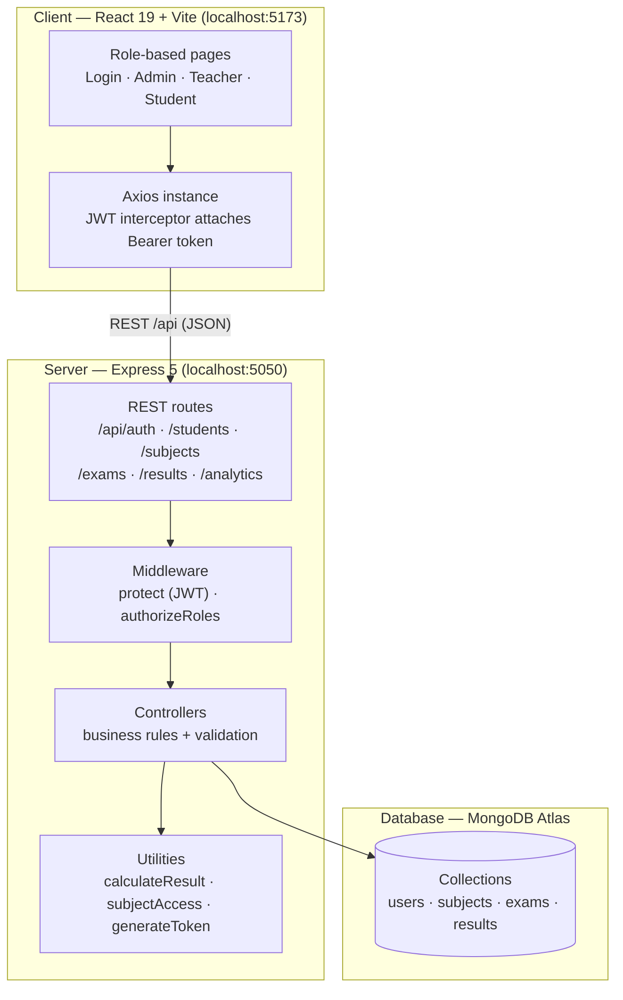
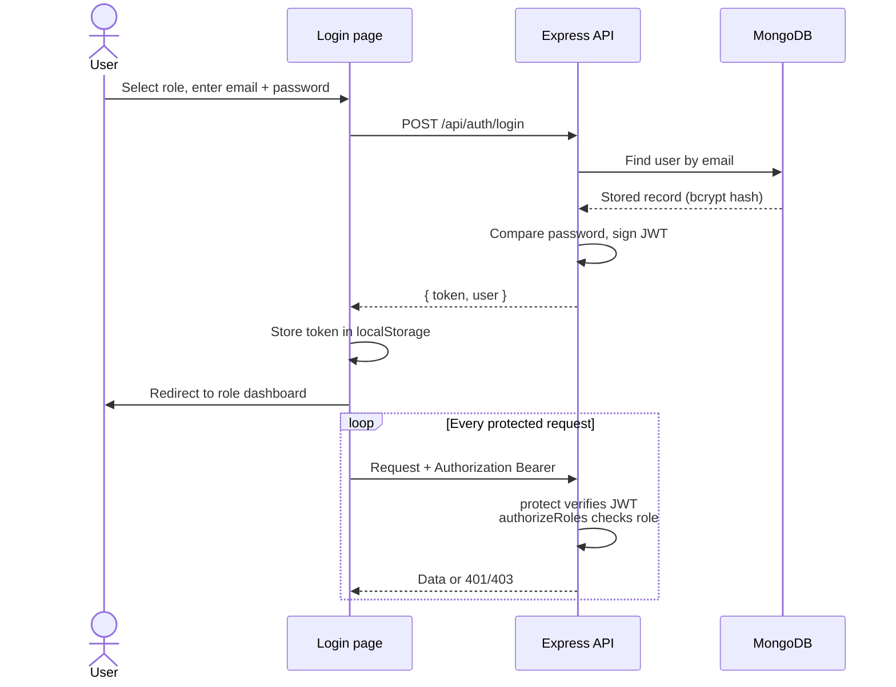
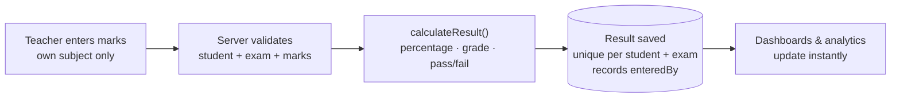

<div align="center">


# 🎓 ResultHub — Student Result Management System

**A full-stack MERN application for managing students, subjects, examinations, marks, and academic results — with role-based portals for administrators, teachers, and students.**

[](https://github.com/fariduddinahmed1/resulthub/actions/workflows/ci.yml)


[](https://resulthub-srms.vercel.app)

</div>

---

## 📖 Project Overview

ResultHub is a college-level **Student Result Management System** that replaces manual marks registers and spreadsheets with a single, role-based web application:

- **Administrators** manage the academic record — students, teachers (in their own dedicated section), subjects, examinations, and results
- **Teachers** enter marks for the subjects assigned to them — enforced server-side
- **Students** view their own results, grades, and performance insights

Every result is computed server-side (percentage, grade, pass/fail) the moment marks are entered, and the same data powers instant analytics: average percentage, pass rate, grade distribution, and subject-wise performance.

The system is built as a classic **MERN** monorepo — a React (Vite) single-page application talking to an Express REST API backed by MongoDB, hosted on **MongoDB Atlas**.

---

## ✨ Key Features

### 🔐 Authentication & Authorization
- JWT-based authentication with bcrypt-hashed passwords (10 rounds)
- Role-based access control for **Admin**, **Teacher**, and **Student**
- Login page with a three-role selector; the chosen role must match the account
- Protected pages and protected API endpoints
- Automatic logout on expired/revoked token; change-password page for all roles

### 🛠️ Admin Portal
- Dashboard with statistics, grade-distribution chart, and subject-wise performance
- **Separate Students and Teachers sections** — manage each role independently
- Create subjects, assign teachers, create examinations
- Enter and update marks; every result records **who entered it** (`enteredBy`)
- Automatic percentage, grade, and pass/fail calculation

### 👨‍🏫 Teacher Portal
- Dashboard scoped to the teacher's own subjects and exams
- Enter and update marks **only for assigned subjects** — enforced server-side
- Class performance and grade distribution for own subjects

### 🎓 Student Portal
- Personal dashboard with results summary (appeared / passed / failed)
- Individual results with marks, percentage, grade, and status
- Download results as a formatted HTML file
- Students can only ever access **their own** results

### 📊 Analytics
- **Admin:** institution-wide average, pass rate, grade distribution, subject-wise performance
- **Teacher:** class performance for own subjects
- **Student:** individual average, strongest subject, performance trend

### 🧰 Engineering Quality
- **17 automated tests** (API integration + unit) on the native Node test runner
- Oxlint + production build enforced by **GitHub Actions CI** on every push
- JSON 404 and global error handler — no stack traces leak to clients

---

## 🛠️ Technology Stack

| Layer | Technologies |
|---|---|
| Frontend | React 19, Vite, React Router 7, Axios, plain CSS |
| Backend | Node.js 20+, Express 5 |
| Database | MongoDB Atlas (cloud), Mongoose 9 |
| Authentication | JSON Web Tokens, bcryptjs |
| Testing | Node.js native test runner, mongodb-memory-server |
| Linting | Oxlint |
| CI/CD | GitHub Actions (tests + lint + build) |
| Version Control | Git, GitHub |

---

## 🏗️ System Architecture and Workflow



### 🔑 Authentication Workflow



### 📝 Marks → Result Workflow



---

## 🚀 Installation and Setup

### Prerequisites

- **Node.js 20+** and npm (CI runs on Node 24)
- **Git**
- **MongoDB** — a local MongoDB server, or a free [MongoDB Atlas](https://www.mongodb.com/atlas) connection string

### 1. Clone the repository

```bash
git clone https://github.com/fariduddinahmed1/resulthub.git
cd resulthub
```

### 2. Configure the backend

```bash
cd server
npm install
cp .env.example .env
```

Edit `server/.env` (never commit it — `.env` is gitignored):

```env
PORT=5050
MONGODB_URI=mongodb://localhost:27017/student-result-management
JWT_SECRET=replace_this_with_a_secure_random_secret_key

# Admin Account Seeding Credentials
ADMIN_NAME="System Administrator"
ADMIN_EMAIL=admin@example.com
ADMIN_PASSWORD=Admin@12345678

# CORS Configuration
CLIENT_URL=http://localhost:5173
```

> Use your own `JWT_SECRET` and admin password in production. `MONGODB_URI` can be an Atlas `mongodb+srv://…` string instead of the local URI.

### 3. Load data

Create a clean admin account:

```bash
npm run create-admin
```

…or seed the full demo dataset — **1 admin, 3 teachers, 10 students, 6 subjects, 12 exams, 108 results**:

```bash
npm run seed
```

### 4. Configure the frontend

Open a **second terminal** from the project root:

```bash
cd client
npm install
cp .env.example .env
```

```env
VITE_API_URL=http://localhost:5050/api
```

---

## ▶️ How to Run the Project

Start the backend in terminal 1 (`http://localhost:5050`):

```bash
cd server
npm run dev
```

Start the frontend in terminal 2 (`http://localhost:5173`):

```bash
cd client
npm run dev
```

Open **http://localhost:5173** and log in with the demo credentials:

| Role | Email | Password |
|---|---|---|
| Admin | `admin@example.com` | `Admin@12345678` |
| Teacher | `asha@college.edu`, `rahul@college.edu`, `priya@college.edu` | `Password@123` |
| Students | `aarav@student.edu` … `ananya@student.edu` (10 students) | `Password@123` |

### Available scripts

| Command | Where | Purpose |
|---|---|---|
| `npm run dev` | `server/` | Start API with hot-reload (nodemon) → `:5050` |
| `npm start` | `server/` | Start API (production) |
| `npm run seed` | `server/` | Load/refresh the demo dataset |
| `npm run create-admin` | `server/` | Create a single admin account |
| `npm test` | `server/` | Run all 17 tests (in-memory MongoDB) |
| `npm run dev` | `client/` | Start Vite dev server → `:5173` |
| `npm run build` | `client/` | Production build to `client/dist/` |
| `npm run lint` | `client/` | Lint the client source |

**CI:** `.github/workflows/ci.yml` automatically runs server tests + client lint + build on every push to GitHub — currently ✅ green.

---

## ☁️ Deployment

| Tier | Service | URL |
|---|---|---|
| Frontend | **Vercel** (static build of `client/`) 
| Backend | **Render** (Node service, root `server/`) 
| Database | **MongoDB Atlas** 

**How the pieces connect:**

- **Vercel** serves the built React SPA; `client/vercel.json` rewrites all routes to `index.html` so client-side routing works on refresh.
- The frontend reads `VITE_API_URL` **at build time** → baked into the bundle as `https://resulthub-rkux.onrender.com/api`.
- **Render** builds with `npm install` and starts with `npm start`, configured with env vars `MONGODB_URI`, `JWT_SECRET`, and `CLIENT_URL` (set to the Vercel URL — the server's CORS allow-list).
- Both environments share the same **Atlas** database.

> ⚠️ Render's free tier sleeps after ~15 minutes without visitors — the first request then takes ~30–50 seconds to wake the service. Later requests are instant.

---

## 📁 Project Folder Structure

```text
resulthub/
├── .github/
│   └── workflows/
│       └── ci.yml                 # Tests + lint + build pipeline
├── client/                        # React SPA (Vite)
│   ├── public/
│   │   └── favicon.svg            # App logo
│   ├── src/
│   │   ├── components/            # AdminLayout, GradeChart, ProtectedRoute
│   │   ├── context/               # AuthContext (session + token)
│   │   ├── pages/                 # Login, AdminDashboard, Students, Subjects,
│   │   │                          # Exams, Results, TeacherDashboard,
│   │   │                          # TeacherMarks, StudentDashboard,
│   │   │                          # StudentResults, ChangePassword
│   │   ├── services/
│   │   │   └── api.js             # Axios instance + JWT interceptors
│   │   ├── App.jsx                # Routes (role-protected)
│   │   ├── App.css / index.css    # Teal UI theme
│   │   └── navigationItems.js     # Sidebar menus (admin + teacher)
│   ├── index.html
│   ├── vite.config.js
│   ├── vercel.json                # SPA rewrite rule (static deploy)
│   └── .env.example
├── server/                        # Express REST API
│   ├── config/                    # MongoDB connection
│   ├── controllers/               # auth, student, subject, exam, result, analytics
│   ├── middleware/                # protect, authorizeRoles
│   ├── models/                    # User, Subject, Exam, Result (Mongoose)
│   ├── routes/                    # 7 route modules mounted under /api
│   ├── scripts/                   # seed.js, createAdmin.js
│   ├── tests/                     # api.test.js, calculateResult.test.js
│   ├── utils/                     # calculateResult, generateToken, subjectAccess
│   ├── app.js                     # Express app: CORS, routes, error handling
│   ├── server.js                  # Entry point: connect DB + listen
│   └── .env.example
├── LICENSE                        # MIT
└── README.md
```

---

## 📄 License

Licensed under the **MIT License** — see [LICENSE](LICENSE) for the full text.

Copyright © 2026 Fariduddin Ahmed.

---

## 🙏 Acknowledgements

- [MongoDB Atlas](https://www.mongodb.com/atlas) — free cloud database tier
- [Express](https://expressjs.com/), [React](https://react.dev/), [Vite](https://vite.dev/) — the core stack
- [Mongoose](https://mongoosejs.com/) — elegant MongoDB object modeling
- [GitHub Actions](https://github.com/features/actions) — free CI for the repository
- [Oxlint](https://oxc.rs/) — fast JavaScript/React linting

---

## 👤 Developed by

**Fariduddin Ahmed** — [@fariduddinahmed1](https://github.com/fariduddinahmed1)
